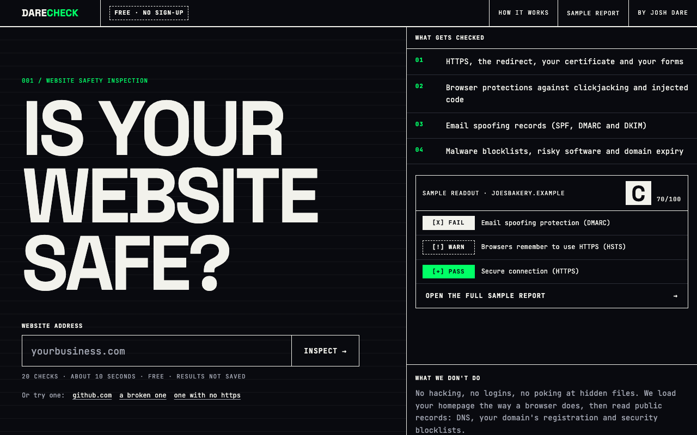
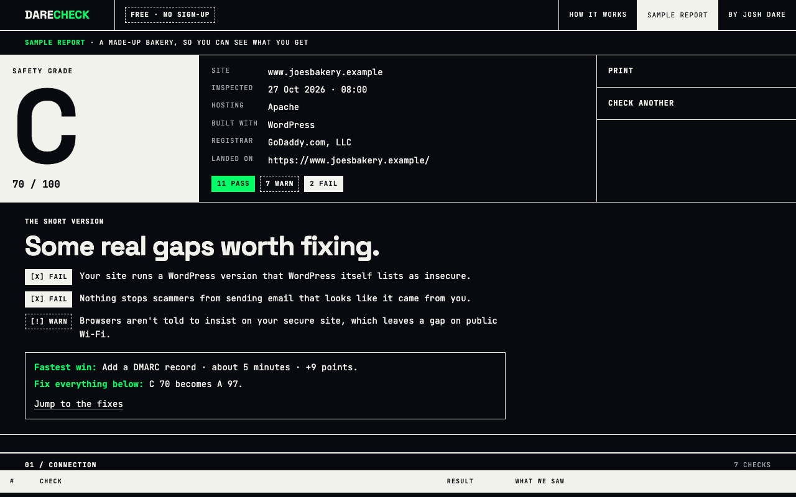
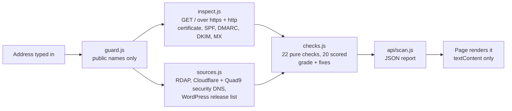
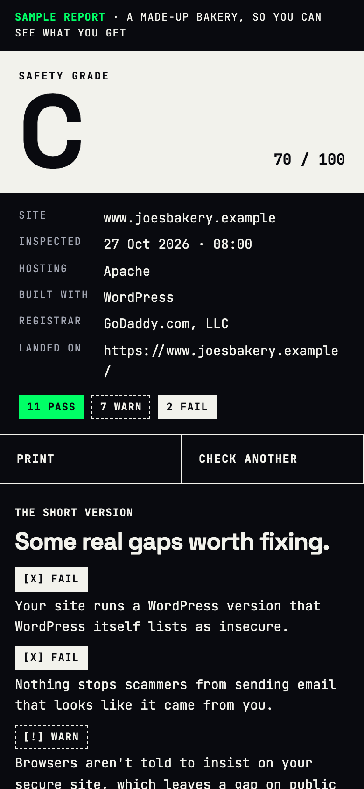

# DARE CHECK

**A free 10-second safety grade for small-business websites.** Type an address and get a letter grade, twenty scored checks explained in plain English, and copy-paste fixes for the host the site actually runs on. Also a CLI, a GitHub Action and an MCP server.

**Live:** [dare-check.vercel.app](https://dare-check.vercel.app)


<sub>Screenshots captured from the live site with Playwright on 2026-11-17.</sub>

Most small-business owners have never been told whether their site is missing HTTPS, or whether anyone can send email that looks like it came from their domain. DARE CHECK looks at the same things a security pro checks first, and only the things any browser can see.

## What it checks

| Group | Checks | Points |
|---|---|---|
| Connection | HTTPS, the http→https redirect, the certificate, HSTS, insecure files on the page, forms that post over http, `www` and bare domain agreeing | 42 |
| Browser protections | clickjacking (frame-ancestors / X-Frame-Options), nosniff, Content-Security-Policy, Referrer-Policy, Permissions-Policy, cookie flags, leaked software versions | 24 |
| Email | SPF and DMARC, the two records that stop people spoofing your domain (DKIM is reported, not scored) | 16 |
| Reputation and upkeep | not on a malware or scam blocklist, no known-risky software versions, domain not about to expire, domain transfer lock (other companies' scripts are reported, not scored) | 18 |

That is 20 scored checks and 2 reported ones, 22 in all (`lib/checks.js`).

A pass earns a check's full points, a warning half, a fail none. Checks that can't run leave the total instead of costing points. 90+ is an A, 80 a B, 65 a C, 50 a D. A site without working HTTPS, or one that security filters list as dangerous, is an F no matter what else it gets right. If the homepage answers with an error status, the report says the grade may describe the error page.

The fixes are written for the host it detects: `vercel.json`, Netlify `_headers`, `.htaccess`, nginx, IIS `web.config`, Cloudflare Transform Rules, or plain advice for builders like Wix and Squarespace that don't let owners set headers. The email fixes follow the domain's mail provider (Google Workspace, Microsoft 365, or no mail at all).



## How it works



- **`lib/guard.js`**: the SSRF guard. A stranger types the address, so every request must stay on the public internet. It rejects IPs, ports, credentials and private-network names when the address is typed, then checks *every resolved address at connect time* with a custom `lookup`. That covers redirects and DNS rebinding, plus IPv4 hidden inside IPv6 (mapped, NAT64, 6to4). Redirects to IP literals, which skip DNS entirely, are checked separately.
- **`lib/inspect.js`**: read-only collection. It sends GET `/` only, follows redirects by hand (five at most), caps the body at 256 KB and enforces one 15-second deadline. A bad certificate still gets read, so the report can say *why* it's bad.
- **`lib/sources.js`**: public lookups that never touch the scanned site: the domain's registry record over RDAP (expiry and transfer lock), Cloudflare's and Quad9's security DNS filters (the blocklist check), and WordPress's list of insecure releases. None needs an API key, and each one fails soft: if a service is down, its check is skipped rather than guessed.
- **`lib/checks.js`**: pure functions from observations to report, with no network involved, so they're easy to test. Nothing from the scanned page's HTML leaves the server.
- **`api/scan.js`**: a POST-only Vercel function with a per-visitor rate limit (8 a minute), a 2-minute cache and plain-English errors. Results are never written anywhere.
- **`public/`**: one static page with no framework and no dependencies. Every value from a scanned site is untrusted, so the DOM is built with `textContent`. The page runs under a strict CSP: `script-src 'self'`, no inline code, `frame-ancestors 'none'`.

## Use it from the command line, CI or an AI assistant

**CLI** (Node 20+, no install beyond cloning):

```bash
node bin/dare-check.js example.com                 # print a report
node bin/dare-check.js example.com --json          # the report as JSON
node bin/dare-check.js example.com --fail-under B  # exit 1 if the grade is below B
node bin/dare-check.js --batch sites.txt --csv out.csv --md out.md
```

**GitHub Action** (`action.yml`): grade a site in CI and fail the step below a grade. Outputs `grade` and `score`.

```yaml
- uses: Waleee7/dare-check@main
  with:
    url: example.com
    fail-under: C
```

**MCP server** (`bin/dare-check-mcp.js`, stdio): one tool, `check_website`, that returns the same report to Claude or any MCP client.

```bash
claude mcp add dare-check -- node /path/to/dare-check/bin/dare-check-mcp.js
```

All three are read-only: they load the homepage the way a browser does and read public records.

## Run it

```bash
npm test                    # 115 unit and integration tests, no network needed
PORT=5190 node server.js    # http://127.0.0.1:5190
node tests/ui.check.cjs     # 70 browser checks against the running server (needs Playwright)
```

Requires Node 20+. No dependencies.

## Verified

Last run on 2026-11-17:

- **115 of 115 tests pass** (`npm test`, 8 files): grading rules, SPF/DMARC/DKIM parsing, platform detection, the SSRF guard (including cloud-metadata and IPv6-embedded addresses), the redirect walker against real local servers (including a server that drips one byte at a time), a real self-signed certificate, the RDAP, DNS-filter and WordPress lookups, the CLI, the MCP server, the rate limiter, and a check that the page's grade table matches the engine. CI runs the same suite on Node 20 and 22.
- **70 of 70 browser checks pass** (`tests/ui.check.cjs`, Playwright, against a local server): the sample report, copy buttons, error states, shared links, print view, reduced motion, phone layout with 44 px targets and no sideways scroll, zero console or CSP errors, and a hostile report whose fields carry `<script>` and `onerror` payloads, which render as harmless text.
- **Lighthouse (mobile and desktop), at the first release:** Accessibility 100, Best Practices 100. SEO is held down only by the pre-launch `noindex`. Not re-run since the engine rebuild.



## Limits

DARE CHECK covers the basics that stop the most common attacks. It is not a penetration test and doesn't look past the homepage. The rate limit and cache live in each function instance's memory, which is fine for a free tool but not for a high-traffic one.

## Status

Live at [dare-check.vercel.app](https://dare-check.vercel.app), serving this repo's `main` (checked 2026-11-17). Search indexing is off (`noindex`) until launch.

## Roadmap

- Launch: lift the `noindex`.
- Move the rate limit and cache out of per-instance memory if traffic grows.
- Decide whether a homepage that answers with a 5xx error should cap the grade (today it adds a caveat).

## Credits

Built by [Akinwale Dare](https://github.com/Waleee7). Public data comes from the domain registries' RDAP service, Cloudflare's and Quad9's security DNS filters, and the WordPress.org release API.
