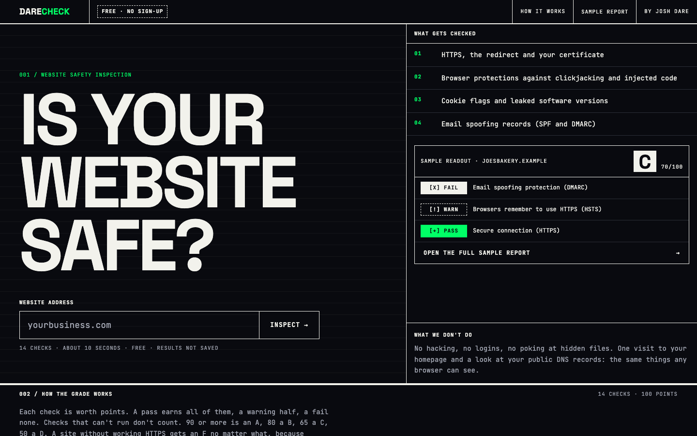
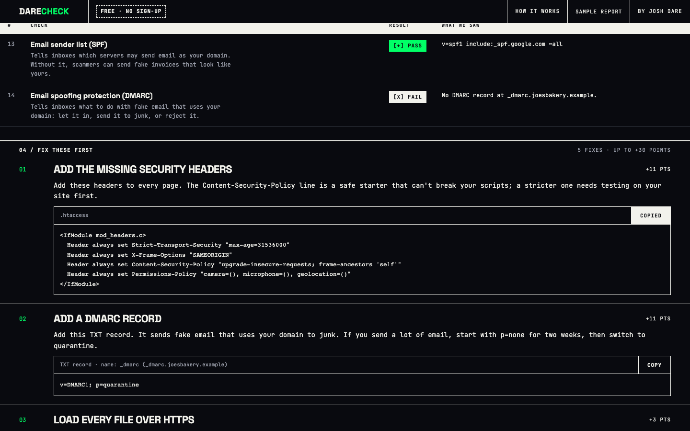
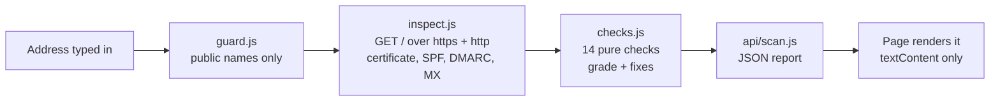
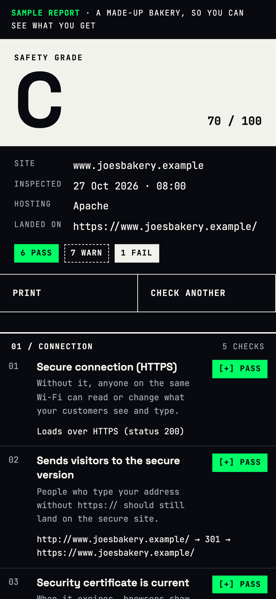

# DARE CHECK

**A free 10-second safety grade for small-business websites.** Type an address and get a letter grade, fourteen checks explained in plain English, and copy-paste fixes for the host the site actually runs on.



Most small-business owners have never been told whether their site is missing HTTPS, or whether anyone can send email that looks like it came from their domain. DARE CHECK looks at the same things a security pro checks first, and only the things any browser can see.

## What it checks

| Group | Checks | Points |
|---|---|---|
| Connection | HTTPS, the http→https redirect, certificate expiry, HSTS, insecure files on the page | 50 |
| Browser protections | clickjacking (frame-ancestors / X-Frame-Options), nosniff, Content-Security-Policy, Referrer-Policy, Permissions-Policy, cookie flags, leaked software versions | 30 |
| Email | SPF and DMARC records, the two that stop people spoofing your domain | 20 |

A pass earns a check's full points, a warning half, a fail none. Checks that can't run leave the total instead of costing points. 90+ is an A, 80 a B, 65 a C, 50 a D. A site without working HTTPS is an F no matter what else it gets right.

The fixes are written for the host it detects: `vercel.json`, Netlify `_headers`, `.htaccess`, nginx, IIS `web.config`, Cloudflare Transform Rules, or plain advice for builders like Wix and Squarespace that don't let owners set headers. The email fixes follow the domain's mail provider (Google Workspace, Microsoft 365, or no mail at all).



## How it works



- **`lib/guard.js`**: the SSRF guard. A stranger types the address, so every request must stay on the public internet. It rejects IPs, ports, credentials and private-network names when the address is typed, then checks *every resolved address at connect time* with a custom `lookup`. That covers redirects and DNS rebinding, plus IPv4 hidden inside IPv6 (mapped, NAT64, 6to4). Redirects to IP literals, which skip DNS entirely, are checked separately.
- **`lib/inspect.js`**: read-only collection. It sends GET `/` only, follows redirects by hand (five at most), caps the body at 256 KB and enforces one 15-second deadline. A bad certificate still gets read, so the report can say *why* it's bad.
- **`lib/checks.js`**: pure functions from observations to report, with no network involved, so they're easy to test. Nothing from the scanned page's HTML leaves the server.
- **`api/scan.js`**: a POST-only Vercel function with a per-visitor rate limit (8 a minute), a 2-minute cache and plain-English errors. Results are never written anywhere.
- **`public/`**: one static page with no framework and no dependencies. Every value from a scanned site is untrusted, so the DOM is built with `textContent`. The page runs under a strict CSP: `script-src 'self'`, no inline code, `frame-ancestors 'none'`.

## Run it

```bash
npm test                    # 39 unit and integration tests, no network needed
PORT=5190 node server.js    # http://127.0.0.1:5190
node tests/ui.check.cjs     # 23 browser checks against the running server (needs Playwright)
```

Requires Node 20+. No dependencies.

## Verified

- **39 tests pass:** grading rules, SPF/DMARC parsing, platform detection, the SSRF guard (40 address cases, including cloud-metadata and IPv6-embedded forms), the redirect walker against real local servers (including a server that drips one byte at a time), a real self-signed certificate, the rate limiter, and a check that the page's grade table matches the engine.
- **23 browser checks pass:** the sample report, copy buttons, error states, shared links, print view, reduced motion, phone layout with no sideways scroll, zero console or CSP errors, and a hostile report whose fields carry `<script>` and `onerror` payloads, which render as harmless text.
- **Lighthouse (mobile and desktop):** Accessibility 100, Best Practices 100. SEO is held down only by the pre-launch `noindex`.



## Limits

DARE CHECK covers the basics that stop the most common attacks. It is not a penetration test and doesn't look past the homepage. The rate limit and cache live in each function instance's memory, which is fine for a free tool but not for a high-traffic one.

Built by Joshua Dare.
